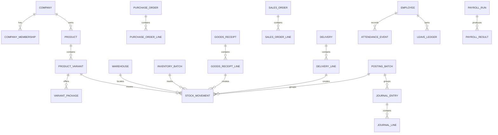

# Database Design

## 1. Purpose and Scope

This document proposes the logical database design for the ERP. It is a technical design, not a final SQL schema. Field-level definitions, migrations, and database policies will be produced during implementation after the open business decisions are resolved.

## 2. Design Principles

1. PostgreSQL is the system of record.
2. Every tenant-owned table contains a non-null `company_id`.
3. Foreign keys include or validate company scope so records cannot link across tenants.
4. Posted stock and accounting ledgers are append-only.
5. Operational documents keep snapshots of names, units, conversions, prices, exchange rates, taxes, and rule versions needed to explain history.
6. Money and quantity use fixed-precision decimal types.
7. Timestamps are stored in UTC; business dates and effective dates are stored separately.
8. Deactivation is preferred over deletion for referenced master data.
9. Large derived balances may be cached, but must be rebuildable from source ledgers.
10. Posting is idempotent and atomic.

## 3. Database Conventions

- Primary keys: UUID version 7 or another time-sortable globally unique identifier.
- Tenant key: `company_id` on all company-owned records.
- Optimistic concurrency: `version` on editable documents and master data.
- Audit columns: `created_at`, `created_by`, `updated_at`, and `updated_by` where updates are allowed.
- Posting columns: `posted_at`, `posted_by`, `posting_batch_id`, and `reversal_of_id` where relevant.
- Dates: `date` for business dates; `timestamptz` for events.
- Quantity: configurable `numeric` precision suitable for the supported unit precision.
- Money: `numeric` amount plus ISO currency code; no floating-point money.
- Status: constrained text or database enum only when migrations can safely manage its lifecycle.
- Names: human-readable document numbers are unique within company, document type, and sequence scope; they are not primary keys.
- Metadata: JSON is reserved for genuinely variable external payloads or snapshots, not core fields that need constraints and reporting.

## 4. Tenant and Platform Model

### Platform Tables

- `platform_users`: Global identity profile linked to the identity provider.
- `companies`: Tenant identity, legal details, status, base currency, time zone, and data region.
- `company_memberships`: User-to-company membership and lifecycle state.
- `subscription_plans`: Plan definitions and entitlements.
- `company_subscriptions`: Trial, plan, period, billing status, and limits.
- `usage_counters`: Measured plan usage by company and period.
- `support_cases`: Support request and company context.
- `support_sessions`: Purpose-bound, scoped, time-limited support access.
- `platform_admin_roles` and `platform_admin_assignments`: Separate platform authority.
- `platform_security_events`: Platform access and risk events.

Company status should distinguish at least pending, trial, active, past due, suspended, closing, and closed without deleting business records.

## 5. Identity, Roles, and Authorization

- `roles`: Company role definitions and protected role templates.
- `permissions`: Stable permission codes.
- `role_permissions`: Many-to-many role permission grants.
- `membership_roles`: Roles assigned to a company membership.
- `data_scopes`: Scope definitions such as all company, selected warehouses, or own records.
- `membership_scopes`: Scope assignments by user, role, and domain.
- `approval_policies`: Versioned workflow selection rules.
- `approval_steps`: Ordered levels, approver groups, and decision rules.
- `approval_instances`: Frozen route for one submitted document.
- `approval_tasks`: Individual actionable approval work.
- `approval_decisions`: Immutable decision history.
- `delegations`: Temporary, dated approval delegation.

Permissions are evaluated by the application, with database row-level security as defense in depth. Sensitive permission changes are themselves audited and may require approval.

## 6. Organization and Shared Master Data

- `branches`: Operating branches within a company.
- `warehouses`: Physical or logical stock facilities.
- `warehouse_locations`: Hierarchical receiving, storage, picking, quarantine, and dispatch locations.
- `departments`, `cost_centres`, and `projects`: Organizational reporting dimensions.
- `document_sequences`: Company-specific numbering by type, branch, and period.
- `currencies` and `exchange_rates`: Currency reference and dated company rates.
- `tax_codes` and `tax_rates`: Versioned tax configuration.
- `addresses`, `contacts`, and `attachments`: Reusable company-scoped support records.
- `reason_codes`: Controlled reasons for returns, adjustments, reversals, and corrections.

## 7. Product, Packaging, and Inventory Tables

### Product Master

- `product_categories`
- `brands`
- `products`: Shared commercial family.
- `variant_attributes` and `variant_attribute_values`
- `product_variants`: Stock identity, SKU, base unit, tracking and costing policy.
- `units_of_measure`: System and company units with dimension and precision.
- `variant_packages`: Effective-dated package conversion directly to base.
- `package_barcodes`: One or more company-unique barcode aliases.
- `price_lists`, `price_list_entries`: Effective-dated package selling prices.
- `supplier_item_prices`: Supplier package prices, lead times, and supplier codes.
- `reorder_policies`: Variant and warehouse replenishment settings.

### Tracking and Stock

- `inventory_batches`: Variant batch, dates, and status.
- `inventory_serials`: Variant serial identity and descriptive attributes.
- `stock_movements`: Immutable signed base quantities and valuation references.
- `stock_movement_serials`: Optional expansion if one movement header groups multiple serials; one serial event remains individually constrained.
- `stock_balance_projection`: Rebuildable quantity cache by complete stock dimension.
- `stock_reservations`: Open demand allocation in base units.
- `inventory_cost_layers`: FIFO or specific-cost layers when selected.
- `inventory_cost_events`: Cost consumption, adjustment, and revaluation history.
- `stock_count_headers`, `stock_count_lines`, `stock_count_entries`: Count snapshot, independent entries, and approved result.
- `stock_adjustments` and `stock_adjustment_lines`: Controlled source documents for variance movements.
- `stock_transfers` and `stock_transfer_lines`: Request, dispatch, in-transit, and receipt state.
- `assembly_orders`, `assembly_inputs`, and `assembly_outputs`: Limited production source records.

### Stock Movement Key Fields

`stock_movements` should include:

- `id`, `company_id`, `posting_batch_id`
- `variant_id`, `base_unit_id`, `quantity_base`
- `warehouse_id`, `location_id`, `stock_status`
- `batch_id`, `serial_id` or serial expansion link
- `movement_type`, `business_date`, `posted_at`
- `source_type`, `source_id`, `source_line_id`, `source_number`
- `unit_cost_base_currency`, `value_base_currency`
- `reversal_of_movement_id`, `reason_code_id`
- `posted_by`

Movement rows are not updated or deleted. Corrections append reversal and replacement rows.

## 8. Purchasing Tables

- `suppliers` and `supplier_contacts`
- `purchase_requisitions` and `purchase_requisition_lines`
- `supplier_quote_requests`, `supplier_quotes`, and lines
- `purchase_orders` and `purchase_order_lines`
- `goods_receipts` and `goods_receipt_lines`
- `goods_receipt_tracking`: Batch, expiry, serial, location, accepted, and rejected quantities.
- `supplier_bills` and `supplier_bill_lines`
- `purchase_matches`: Links order, receipt, and bill quantities/values.
- `supplier_returns` and `supplier_return_lines`
- `supplier_debit_notes` and lines
- `supplier_payments` and `supplier_payment_allocations`

Every inventory line snapshots selected package, package quantity, conversion, base quantity, package price, tax, discount, and currency information.

## 9. Sales Tables

- `customers` and `customer_contacts`
- `sales_quotations` and `sales_quotation_lines`
- `sales_orders` and `sales_order_lines`
- `pick_lists`, `pick_list_lines`, and tracking allocations
- `deliveries` and `delivery_lines`
- `sales_invoices` and `sales_invoice_lines`
- `customer_receipts` and `customer_receipt_allocations`
- `customer_return_authorizations`
- `customer_returns` and `customer_return_lines`
- `credit_notes` and lines
- `customer_refunds` and allocations

Order, reservation, delivery, invoice, receipt, and return are separate records because they may occur at different times and quantities.

## 10. Accounting Tables

- `accounting_periods`: Open, soft-closed, or locked periods.
- `accounts`: Company chart of accounts and account type.
- `account_dimensions`: Allowed branch, cost centre, project, or other dimensions.
- `journal_entries`: Immutable posted journal header.
- `journal_lines`: Debit/credit lines in transaction and base currency.
- `posting_batches`: Atomic link between operational posting, stock movements, and journal entries.
- `posting_rules`: Versioned mappings from business event to accounts.
- `receivable_items` and `payable_items`: Open-item subledgers.
- `allocations`: Immutable payment, credit, and adjustment allocation history.
- `bank_accounts` and `bank_transactions`
- `bank_statements`, `bank_statement_lines`, and `bank_reconciliation_matches`
- `tax_transactions`: Tax detail linked to source and journal.
- `fixed_assets`, `depreciation_runs`, and events when the module is enabled.

A journal entry must have at least two lines and total debits must equal total credits in each required balancing currency. Posted lines cannot be changed.

## 11. Expense Tables

- `expense_categories` and `expense_policies`
- `expense_claims` and `expense_lines`
- `expense_receipts`: Attachment metadata and duplicate-detection fingerprint.
- `recurring_expense_templates`
- `employee_reimbursements`

Expenses link to approval, tax, accounting, payment, employee, cost centre, and project records as applicable.

## 12. HR, Attendance, Leave, and Payroll Tables

### HR

- `employees`: Employment identity and status, separate from platform user account.
- `employee_private_details`: More restricted personal and government data.
- `employment_contracts`: Effective-dated employment terms.
- `positions`, `departments`, `reporting_lines`
- `compensation_profiles`: Restricted, effective-dated pay configuration.
- `employee_bank_accounts`: Encrypted and tightly scoped.

### Attendance and Leave

- `work_calendars`, `shifts`, `shift_assignments`, `holidays`
- `attendance_events`: Immutable raw clock/device/manual source events.
- `attendance_results`: Calculated daily/period outcomes by rule version.
- `attendance_corrections`: Reasoned, approved correction layer.
- `timesheets` and `timesheet_lines`
- `leave_types`, `leave_policies`, `leave_policy_assignments`
- `leave_ledger`: Immutable grants, accruals, usage, expiry, and reversals.
- `leave_requests` and approvals

### Payroll

- `payroll_components`: Earnings, deductions, benefits, taxes, loans, and employer costs.
- `payroll_rules`: Effective-dated formulas and statutory configuration.
- `employee_payroll_components`: Employee-specific inputs.
- `payroll_periods`
- `payroll_runs`: A run and its lifecycle.
- `payroll_calculation_versions`: Immutable input/rule snapshot for each calculation.
- `payroll_results` and `payroll_result_lines`
- `payslips`
- `payroll_payment_batches`
- `payroll_journal_links`

Finalized results are not overwritten. Corrections create another version before approval or an off-cycle/reversal run after finalization.

## 13. Reporting, Audit, and Integration Tables

- `audit_events`: Actor, company, action, target, before/after summary, reason, request ID, IP/device context, and time.
- `access_events`: Login, failure, MFA, session, support, export, and security events.
- `outbox_events`: Transactional events awaiting reliable publication.
- `inbox_messages`: Deduplication of received integration messages.
- `background_jobs`: Tenant, type, status, attempts, and result reference.
- `report_exports`: Requested filters, scope, file reference, expiry, and downloads.
- `webhook_endpoints`, `webhook_deliveries`, and signing-secret references.
- `api_clients` and credential metadata; raw secrets are not stored in ordinary table fields.
- `import_jobs`, `import_rows`, and validation errors.
- `notifications` and delivery attempts.

## 14. Relationship Overview

The final model will contain additional links for tenant validation, approvals, tracking details, reversals, and allocations.

## 15. Tenant Isolation

### Application Rules

- The authenticated request establishes one active company context.
- Repository and query APIs require company context; there is no unscoped tenant repository for normal application code.
- Identifiers supplied by a client are always resolved with `company_id`.
- Background jobs carry company context and reauthorize sensitive actions.

### Database Rules

- PostgreSQL row-level security should protect tenant tables as defense in depth.
- A transaction-local company setting is established only after authentication and authorization.
- Composite unique constraints include `company_id`.
- Cross-table triggers or composite foreign keys prevent cross-company references where ordinary foreign keys cannot.
- The application database role must not bypass row-level security.
- Platform operations use separate roles and controlled service paths.

Automated tests must attempt cross-tenant reads and writes for every repository and sensitive API family.

## 16. Posting and Idempotency

A posting command includes a unique idempotency key. Within one database transaction it:

1. Locks and validates the source document and relevant stock/period state.
2. Verifies the command has not already completed.
3. Creates a posting batch.
4. Appends stock movements and updates the rebuildable projection.
5. Appends journal entries and subledger items when required.
6. Changes the source document state.
7. Appends audit and outbox records.
8. Commits all effects together.

A retry returns the completed result rather than posting twice.

## 17. Indexing and Scale

Initial indexes should cover:

- Every table's `company_id` plus common date/status filters
- Company plus document number
- Company plus SKU and active barcode
- Stock ledger by company, variant, warehouse, business date, batch, and serial
- Open reservations by stock key
- Open receivable/payable items by party and due date
- Approval tasks by assignee/status
- Attendance and payroll by employee and period
- Audit and access events by company, actor, target, and time

Large stock movements, journal lines, audit events, and attendance events may be time-partitioned after measured need. Partitioning must not weaken tenant constraints or make reversal links unreliable.

Read replicas may serve stale-tolerant reporting, but availability checks, posting validation, and approval actions use the primary database.

## 18. Data Retention and Deletion

- Posted ledgers, payroll, tax, and audit data follow legal retention requirements.
- Personal data must be classified and minimized.
- Company closure starts an export, retention, and deletion/anonymization workflow rather than immediate cascading deletion.
- Attachments and exports in object storage follow the same tenant and retention rules as database metadata.
- Legal hold prevents scheduled deletion.
- Backup expiration must be included in deletion commitments.

## 19. Migration Strategy

- Use versioned, reviewed migrations.
- Prefer additive, backward-compatible changes followed by backfill and later cleanup.
- Large backfills run in bounded batches and are observable.
- Ledger changes require reconciliation scripts and rollback plans.
- Seed data is limited to stable system permissions, units, and templates; company data is created through onboarding.
- Production changes are tested against representative data volume.

## Open Business Decisions

1. Will a company represent one legal entity or may it contain multiple legal entities?
2. Is a shared-database tenant model acceptable for all plans, or do enterprise tenants require separate databases?
3. What quantity and money precision is required?
4. Which inventory valuation method determines the cost table design?
5. Which accounting dimensions and balancing rules are mandatory?
6. Which tax jurisdictions and payroll localization tables are needed first?
7. What are the data residency, retention, deletion, RPO, and RTO requirements?
8. Are custom fields required, and on which records?
9. Are customer and supplier contacts shared across branches?
10. Are document sequences company-wide, branch-specific, or configurable?
11. Which tables need temporal history beyond audit events?
12. What expected tenant size, transaction volume, employee count, and report horizon should capacity tests use?
