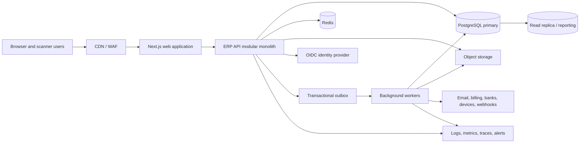

# System Architecture

## 1. Purpose

This document recommends a scalable technical architecture for the ERP. It translates the business requirements into deployable components and engineering boundaries. It does not replace the product requirements or business workflow definitions.

## 2. Recommended Architecture

Start with a **modular monolith** backed by PostgreSQL, plus separate background workers. Keep strict domain module boundaries and publish transactional events through an outbox.

This approach is safer than early microservices for an ERP because stock posting, accounting, approvals, and operational documents require strong transactions and consistent rules. It also leaves a controlled path to extract high-volume or independently scaled modules later.

### Logical Modules

- Platform administration and subscriptions
- Identity, tenant context, roles, permissions, and approvals
- Organization and shared master data
- Product, packaging, pricing, and inventory
- Purchasing and suppliers
- Sales and customers
- Warehouses and fulfillment
- Expenses
- Accounting and finance
- Employees, attendance, and leave
- Payroll
- Reporting and exports
- Notifications, integrations, and audit

Modules own their application services and data access. Cross-module writes occur through explicit commands or posting orchestration, not direct ad hoc table updates.

## 3. Recommended Technology Stack

| Layer | Recommendation | Reason |
|---|---|---|
| Language | TypeScript | Shared language, mature web ecosystem, strong typing |
| Web application | Next.js with React | Accessible responsive UI, routing, server rendering where useful |
| UI system | Tailwind CSS plus an accessible component foundation such as Radix UI/shadcn conventions | Consistent, composable enterprise screens without locking business logic into a visual library |
| API | NestJS using the Fastify adapter | Structured modules, validation, guards, OpenAPI support, and good TypeScript ergonomics |
| API style | Versioned REST with OpenAPI; webhooks/events for integrations | Predictable ERP operations and broad integration support |
| Database | PostgreSQL, preferably managed | Transactions, constraints, row-level security, JSON where justified, reporting strength |
| SQL access | SQL-first migrations with Kysely or Drizzle-style typed queries; use explicit SQL for ledgers and reports | Keeps complex financial and tenant queries visible and controllable |
| Cache/coordination | Redis | Short-lived caching, rate limits, locks, and job coordination; never the stock source of truth |
| Background jobs | BullMQ initially | Reliable TypeScript job processing for reports, imports, notifications, and payroll calculations |
| Object storage | S3-compatible managed storage | Attachments, imports, exports, generated statements, and payslips |
| Identity | Standards-based managed OIDC provider; enterprise SAML/SCIM later | MFA, session security, federation, and reduced custom authentication risk |
| Observability | OpenTelemetry, structured logs, Prometheus-compatible metrics, and an error tracker | End-to-end request/job visibility and production diagnosis |
| Testing | Vitest/Jest, Testcontainers, contract tests, and Playwright | Unit, real database, API, and browser coverage |
| Delivery | Docker, managed container platform, Terraform, and CI/CD | Repeatable environments and gradual scale |
| Analytics | PostgreSQL read models first; warehouse/BI platform later | Avoids premature data infrastructure while preserving an upgrade path |

Exact vendors should be selected after region, compliance, cost, and team skill decisions. Use portable protocols and S3/PostgreSQL-compatible services to reduce vendor lock-in.

## 4. Runtime Components

### Web Application

- Provides role-aware company and Super Admin experiences.
- Uses generated API clients from OpenAPI where practical.
- Keeps authorization decisions on the server; client checks improve usability only.
- Supports scanner-friendly workflows and accessible keyboard navigation.
- Avoids storing sensitive business data in long-lived browser storage.

### ERP API

- Authenticates requests and establishes active company context.
- Enforces permissions, data scope, workflow state, and approval limits.
- Runs business commands and transactional posting.
- Exposes query endpoints designed for screens and integration consumers.
- Generates audit and outbox events in the same transaction as business changes.

### Worker Service

- Processes imports, exports, report generation, notification delivery, webhook delivery, expiry alerts, attendance calculations, and payroll calculations.
- Uses idempotent job handlers with bounded retries and a dead-letter process.
- Rechecks tenant status and authorization context where a delayed action can change business data.
- Does not bypass domain posting services.

## 5. Multi-Tenant Architecture

The recommended initial model is a shared application and shared PostgreSQL database with `company_id` on every tenant-owned row.

Isolation controls:

1. An authenticated user selects an active company membership.
2. A signed server session or short-lived token identifies the user; the server resolves membership and tenant status.
3. Every application command and query requires a tenant context.
4. Database row-level security provides defense in depth.
5. Cache keys, object paths, job payloads, logs, search documents, and metrics include tenant context.
6. Company-specific encryption, residency, or dedicated database options can be added for enterprise plans.
7. Super Admin and support paths use separate authorization policies and audit streams.

Never accept `company_id` from a request body as proof of access.

## 6. Domain and Transaction Boundaries

### Modular Monolith Rules

- Each module exposes application commands, queries, and events.
- A module does not import another module's repository or mutate its tables directly.
- Common kernel code is limited to stable primitives such as identifiers, money, quantity, tenancy, and audit context.
- Stock and accounting posting are coordinated by an explicit posting service.
- Reports use read models and approved views rather than bypassing authorization.

### Posting Transaction

A single database transaction should cover source validation, immutable stock movements, accounting journals, balance projection, status change, audit event, and outbox event when these effects belong to one posting action.

External calls such as email, webhooks, or payment provider requests do not occur inside the database transaction. The outbox triggers them after commit.

### Event Use

Domain events are useful for:

- Notifications
- Search indexing
- Read-model updates
- Usage metering
- Integration webhooks
- Non-critical analytics

Events must not create a window where a posted sale exists without its required stock or accounting effect. Those required effects belong in the posting transaction.

## 7. API Architecture

- Base path such as `/api/v1`.
- JSON request/response contracts and OpenAPI documentation.
- Schema validation at the boundary.
- Idempotency keys for posting, payment, import, and externally retried commands.
- Optimistic concurrency tokens for editable drafts and configuration.
- Cursor pagination for large ledgers; page pagination may be used for bounded lists.
- Consistent error codes, correlation IDs, and field-level validation details.
- Signed, retryable webhooks with replay protection.
- Rate limits by user, company, API client, and risk level.
- No generic CRUD endpoint for ledgers or sensitive configuration.

The detailed module plan is in `07-api-module-plan.md`.

## 8. Data Architecture

### System of Record

PostgreSQL remains authoritative for business state. Redis is never authoritative for stock, balances, approval, payroll, or permissions.

### Read Models

Maintain rebuildable projections for:

- Stock balances and availability
- Customer and supplier open balances
- Dashboard summaries
- Approval inbox
- Report-friendly daily aggregates

Projection lag must be visible. Posting and availability checks use strongly consistent data.

### Search

Begin with PostgreSQL full-text and indexed exact search for document numbers, SKU, barcode, batch, serial, and party details. Add a separate search engine only after measured need. Any search index must carry tenant and data-scope filters and may not reveal unauthorized existence.

### Analytics

MVP operational reports can use indexed PostgreSQL queries, read models, and a read replica for stale-tolerant work. At enterprise scale, stream approved events into a separate warehouse with governed tenant and personal-data controls.

## 9. Security Architecture

- OIDC authentication, MFA for privileged users, secure HTTP-only cookies, and short session lifetimes based on risk.
- Central authorization service combining tenant, permission, scope, state, limits, and segregation rules.
- Encryption in transit and at rest; field-level encryption or tokenization for selected bank and identity data.
- Secrets in a managed secret store, not code, logs, or database configuration tables.
- Web application firewall, secure headers, CSRF protection, input validation, output encoding, and file scanning.
- Strong audit trail for access, exports, configuration, approvals, postings, reversals, support, and security actions.
- Separate production access, break-glass procedures, and privileged-access review.
- Dependency, container, infrastructure, and source-code security scanning in CI.

See `10-security-and-audit-policy.md` for policy detail.

## 10. Reliability and Consistency

- Managed PostgreSQL with multi-zone availability where the service target requires it.
- Point-in-time recovery and encrypted backups with regular restoration tests.
- Idempotent commands and job handlers.
- Transactional outbox and consumer deduplication.
- Health, readiness, and dependency checks.
- Timeouts, bounded retries, circuit breakers, and dead-letter queues for external systems.
- Reconciliation jobs for stock projection versus ledger, subledger versus control account, object metadata versus storage, and outbox delivery.
- Graceful degradation: reporting or notifications may be delayed without allowing unsafe posting.

RPO, RTO, availability, and regional failover are business commitments that must be decided before final deployment design.

## 11. Performance Approach

- Query by tenant and indexed business filters.
- Use server-side pagination and avoid loading unbounded lines.
- Precompute only high-value, rebuildable summaries.
- Send imports, exports, payroll calculation, and large reports to workers.
- Prevent N+1 queries through explicit query services and measured tracing.
- Use connection pooling and define per-tenant fairness limits.
- Load test posting contention, stock reservation, ledger queries, payroll, and large tenant reports.
- Add read replicas or partitioning only after production-like measurement.

## 12. Deployment Topology

### MVP

- One regional production environment
- CDN/WAF
- Horizontally scalable web/API containers
- Separate worker containers
- Managed PostgreSQL and Redis
- Managed object storage and secret store
- Central monitoring and alerting
- Isolated development, test, staging, and production environments

### Scale-Out

- Independently scale web, API, and workers.
- Split job queues by workload and tenant fairness.
- Add read replicas and report workloads.
- Offer dedicated database or regional deployment for qualifying enterprise tenants.
- Extract services only when a module has clear ownership, scale, compliance, or release needs.

Likely later extraction candidates are notifications/integrations, document generation, attendance-device ingestion, search, and analytics. Core stock and accounting should remain together until consistency boundaries are proven.

## 13. Engineering Structure

A recommended monorepo layout when coding begins:

- `apps/web`: Next.js company and platform interfaces
- `apps/api`: NestJS API
- `apps/worker`: background processing
- `packages/domain-*`: module-owned domain and application code
- `packages/contracts`: API/event contracts
- `packages/ui`: accessible shared UI components
- `packages/testing`: fixtures and tenant/security test helpers
- `infra`: deployment and infrastructure definitions
- `docs`: product and architecture documentation

This is a recommendation, not authorization to create application code yet.

## 14. Testing Strategy

- Unit tests for quantity conversions, taxes, approvals, payroll rules, and accounting mappings.
- Property-based tests for conversion, rounding, balanced journals, and reversal invariants.
- Integration tests against real PostgreSQL for transactions, row-level security, locking, and idempotency.
- Contract tests for APIs, events, and webhooks.
- End-to-end tests for purchase, sale, return, transfer, count, period close, attendance, leave, and payroll.
- Cross-tenant security tests for every module and export path.
- Concurrency tests for reservations and stock posting.
- Reconciliation tests that rebuild projections from immutable ledgers.
- Accessibility and responsive browser tests.
- Backup restoration and disaster-recovery exercises before production.

## 15. Architecture Evolution

### MVP

Modular monolith, one primary region, REST API, PostgreSQL reporting/read models, basic webhooks, and managed identity.

### Version 2

Read replicas, richer event integrations, customer/supplier portals, device ingestion, BI pipeline, regional options, and selective module extraction if metrics justify it.

### Enterprise

Dedicated tenant databases or cells, SAML/SCIM, advanced data residency, high availability across regions, warehouse-grade analytics, sophisticated workflow, and stronger compliance automation.

## Open Business Decisions

1. Which cloud provider and production regions are allowed?
2. What availability, RPO, RTO, data residency, and disaster-recovery targets are contractual?
3. Is managed OIDC acceptable, and which SSO/MFA methods are required?
4. Do enterprise tenants require dedicated infrastructure or customer-managed keys?
5. What peak users, tenants, documents, stock movements, employees, and API traffic should the system support?
6. Which external integrations are required in the first release?
7. Is offline warehouse or point-of-sale operation required?
8. Are native mobile apps required later?
9. Which compliance targets are expected: SOC 2, ISO 27001, PCI DSS scope reduction, local privacy laws, or others?
10. Is a data warehouse required in Version 2, and how fresh must analytics be?
11. Which localization packages and statutory reporting engines must be pluggable?
12. What engineering skills, hosting budget, and operational support model are available?
