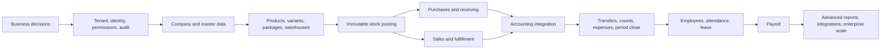

# Development Roadmap

## 1. Purpose

This roadmap defines the safest development sequence and separates MVP, Version 2, and advanced enterprise scope. It does not assign calendar dates because team size, target countries, integrations, and regulatory scope are still open.

## 2. Delivery Principles

- Resolve high-impact business decisions before implementing dependent rules.
- Build in vertical slices that include workflow, permissions, API, database, audit, tests, and usable screens.
- Establish tenant isolation and immutable posting before adding broad module coverage.
- Implement stock quantity before sophisticated costing, but design the cost interfaces early.
- Integrate accounting with each operational flow rather than adding accounting as a disconnected final step.
- Use feature flags and pilot tenants for controlled release.
- Do not call a module complete until reconciliation, reversal, permission, and reporting paths work.

## 3. Phase 0: Product and Risk Decisions

### Outcomes

- Select launch country, currency, tax, payroll, and legal-entity scope.
- Confirm MVP workflows and recognition points.
- Decide inventory valuation, negative stock, package fractions, reservation, and transfer policies.
- Define approval limits and segregation requirements.
- Set target tenant scale, availability, RPO/RTO, retention, and data residency.
- Choose cloud region, identity provider, billing provider, and required launch integrations.
- Validate the domain design with purchase, sales, warehouse, finance, and payroll subject-matter experts.
- Build an acceptance-test catalogue from the business workflows.

### Exit Gate

No implementation of financial, stock valuation, tax, or payroll rules begins with unresolved jurisdiction or recognition assumptions.

## 4. Foundation Release

This is technical product groundwork, not a user-complete ERP release.

### Scope

1. Development environments, CI/CD, secrets, monitoring, and backups
2. Company registration and lifecycle
3. Authentication, MFA integration, company membership, and active tenant context
4. Roles, granular permissions, data scopes, and baseline approvals
5. Tenant-safe database conventions and row-level security
6. Audit and access events
7. Company, branch, warehouse, currency, tax, unit, and document sequence setup
8. Background job, outbox, notification, attachment, import, and export foundations
9. Design system, application shell, accessibility baseline, and error handling
10. Automated cross-tenant and authorization test harness

### Exit Gate

- Cross-tenant access tests pass.
- Privileged actions and support access are auditable.
- Backup restore has been demonstrated.
- A sample document can move through draft and approval safely.

## 5. MVP

The MVP should prove the core trading and control loop for one launch jurisdiction.

### MVP Slice 1: Product and Warehouse Master

- Products and variants
- Base units and packaging conversions
- Package-specific barcodes and prices
- Warehouses and optional locations
- Batch, expiry, and serial tracking policy
- Opening stock workflow
- Stock movement ledger and balance projection
- Stock on hand and movement reports

**Gate:** Package conversions, opening movements, ledger reconstruction, and tenant isolation pass automated tests.

### MVP Slice 2: Purchase and Receiving

- Suppliers
- Purchase orders and approval
- Partial goods receipt
- Package normalization
- Batch, expiry, and serial capture
- Supplier returns
- Receipt and return stock posting
- Basic supplier bill and payable integration

**Gate:** Purchase-to-receipt and return can be fully reversed and stock reconciles to source documents.

### MVP Slice 3: Sales and Fulfillment

- Customers and credit settings
- Quotations or direct orders, according to confirmed MVP scope
- Sales orders, price/discount approval, and reservations
- Pick, pack, delivery, and partial fulfillment
- Invoice and receipt
- Customer return, credit note, and refund controls
- Cost and margin visibility permissions

**Gate:** Concurrent sales cannot oversell blocked stock; delivery and return traces preserve package, batch, and serial identity.

### MVP Slice 4: Inventory Control

- Warehouse transfers with in-transit handling
- Counts, recounts, variance approval, and adjustment
- Quarantine, damaged, and expired stock statuses
- FEFO suggestions
- Reorder and expiry alerts
- Transfer, count variance, expiry, and traceability reports

**Gate:** Transfers preserve total company stock; counts create only approved immutable variance movements.

### MVP Slice 5: Core Accounting and Expenses

- Chart of accounts and versioned posting rules
- Balanced journals generated from purchases, sales, returns, stock, and payments
- General ledger, receivables, payables, cash/bank records
- Expense claims, overhead expenses, approvals, and reimbursement
- Bank reconciliation baseline
- Period open, soft close, lock, reversal, and controlled reopen
- Trial balance, profit and loss, balance sheet, aged receivables/payables, and tax summary

Accounting design begins before inventory slices, but this gate completes the end-user finance module.

**Gate:** Operational documents reconcile to stock, subledgers, control accounts, and the trial balance.

### MVP Slice 6: Employees, Attendance, Leave, and Payroll

- Employee records and restricted personal data
- Departments, positions, calendars, and shifts
- Attendance entry/import baseline, exceptions, corrections, and period close
- Leave types, balances, requests, approval, and leave ledger
- One-country payroll rules, earnings, deductions, taxes, loans, and benefits
- Versioned payroll calculation, approval, payslips, payment instructions, and payroll journal
- Employee self-service

**Gate:** Payroll reconciles to selected inputs, payslips, payments, liabilities, and journal; unauthorized users cannot infer salary data.

### MVP Slice 7: Operations and Launch Readiness

- Role-based dashboards and approval inbox
- Required operational and audit reports
- Super Admin company, subscription, status, access, and support controls
- Usage metering and plan enforcement
- Secure exports and company data export process
- Performance, accessibility, security, recovery, and pilot testing
- User guidance and operational runbooks

**MVP Release Gate:**

- All critical workflows have end-to-end and reversal tests.
- Stock and accounting reconciliation are clean.
- Tenant penetration and authorization tests pass.
- Backup restoration and incident exercises pass.
- Launch-jurisdiction tax and payroll sign-off is recorded.
- Pilot companies complete purchase, sale, return, count, close, and payroll acceptance scenarios.

## 6. Version 2

Version 2 expands automation, channels, and operational depth after the core ledgers are stable.

Candidate scope:

- Purchase requisitions, supplier RFQs, richer three-way match, and landed cost
- Customer and supplier portals
- Advanced price lists, promotions, commissions, and sales targets
- Point-of-sale and payment integrations
- E-commerce, shipping, bank feed, and e-invoicing integrations
- Barcode label designer and variable-weight barcodes
- Quality inspection, recall management, warranty, and repair
- Richer assembly, bills of materials, production orders, and scrap
- Demand planning, reorder suggestions, and supplier lead-time analytics
- Advanced attendance device integration, rostering, and overtime rules
- Additional payroll localization packages
- Fixed assets, budgets, projects, and cost allocation
- Scheduled reports, richer dashboards, and a governed BI pipeline
- Public API, customer API credentials, and expanded webhooks
- SAML SSO and SCIM for qualifying plans
- Read replicas and targeted workload separation based on metrics

Version 2 priorities should be driven by pilot usage and selected markets, not by this list order alone.

## 7. Advanced Enterprise Features

- Multiple legal entities and group consolidation with eliminations
- Intercompany sales, purchases, transfers, and settlement
- Dedicated tenant databases, regional cells, and data residency controls
- Customer-managed encryption keys and advanced key rotation
- Multi-region disaster recovery and higher availability tiers
- Fine-grained policy engine and complex parallel approvals
- Full manufacturing resource planning, capacity, routing, and work centres
- Advanced warehouse management: waves, zones, pallets, handling units, cross-docking, and carrier integration
- Forecasting and inventory optimization
- Enterprise data warehouse, governed semantic layer, and near-real-time analytics
- Advanced fraud, anomaly, and privileged-access monitoring
- Legal hold, e-discovery, and extended compliance evidence
- Extensibility platform with governed custom fields, workflows, apps, and integration marketplace
- Offline mobile warehouse/POS operation where required

## 8. Safest Dependency Order

Accounting chart and posting-rule design happens alongside early stock work. The diagram shows when complete operational accounting becomes testable, not when accountants first join the project.

## 9. Workstream Strategy

Once the foundations are stable, teams may work in parallel only across clear module boundaries. A practical structure is:

- Platform/security: tenancy, identity, authorization, audit, subscriptions
- Supply chain: products, packages, purchasing, sales, warehouses, stock
- Finance: accounting, tax, payments, expenses, reconciliation
- People: employees, attendance, leave, payroll
- Experience/quality: UI system, accessibility, automation, performance, release validation

A domain owner and finance reviewer should approve every event that affects stock value or accounting.

## 10. Definition of Done for a Business Capability

A capability is complete only when it includes:

- Confirmed business rules and acceptance examples
- Tenant-safe data model and migrations
- Permission, data scope, and approval behavior
- API contract and validation
- Accessible user experience
- Audit events
- Posting, reversal, and correction behavior where relevant
- Reconciliation and minimum reports
- Unit, integration, cross-tenant, concurrency, and end-to-end tests
- Monitoring, runbook, and support visibility
- Migration/import path where existing data is expected

## 11. Quality Gates

### Before Every Merge

- Automated formatting, type, unit, security, and migration checks
- Relevant authorization and tenant tests
- Reviewed schema and API changes
- No secrets or sensitive fixtures

### Before Staging Promotion

- Integration and end-to-end workflows pass
- Migration forward/backward compatibility is reviewed
- Observability and alerts exist
- Feature flags and rollback behavior are defined

### Before Production Release

- Performance and concurrency results meet targets
- Security review is complete
- Backup and restore impact is understood
- User acceptance and reconciliation are signed off
- Support documentation and incident ownership are ready

## 12. Data Migration Approach

1. Import company configuration and reference data.
2. Import users and scopes without activating unsafe permissions.
3. Import products, variants, packages, barcodes, customers, suppliers, employees, and accounts.
4. Validate duplicates, units, conversions, taxes, and tracking rules.
5. Post approved opening stock through the ledger.
6. Post approved accounting opening balances and open subledger items.
7. Reconcile stock, receivables, payables, trial balance, leave, and payroll opening values.
8. Record source files, errors, approvals, and cutover date.

Never seed current stock by directly writing a balance projection.

## 13. Roadmap Risks

| Risk | Response |
|---|---|
| Unclear tax/payroll jurisdiction | Resolve before dependent implementation; obtain specialist review |
| Package/variant confusion | Enforce base-unit model and acceptance examples early |
| Cross-tenant data leakage | Defense in depth and automated substitution tests |
| Stock/accounting divergence | Atomic posting and continuous reconciliation |
| Excessive custom workflows | Start with versioned constrained workflow patterns |
| Premature microservices | Keep strong boundaries in a modular monolith and extract by evidence |
| Report load affects posting | Background exports, read models, replicas, and workload limits |
| Scope overwhelms MVP | Release by complete vertical slices and keep Version 2 explicit |

## Open Business Decisions

1. Which exact capabilities are mandatory for the first paying customer?
2. Which country and statutory rules define the first payroll and tax release?
3. Is accounting part of the first pilot or can operational posting launch in a controlled earlier pilot?
4. Are requisitions, quotations, landed cost, production, or POS MVP requirements?
5. How many pilot companies and business types will validate the MVP?
6. What team composition and specialist finance/payroll review are available?
7. What target dates or contractual milestones constrain sequencing?
8. Which integrations must be certified before launch?
9. What availability and support hours apply during MVP?
10. Which Version 2 candidates have committed customers versus exploratory demand?
