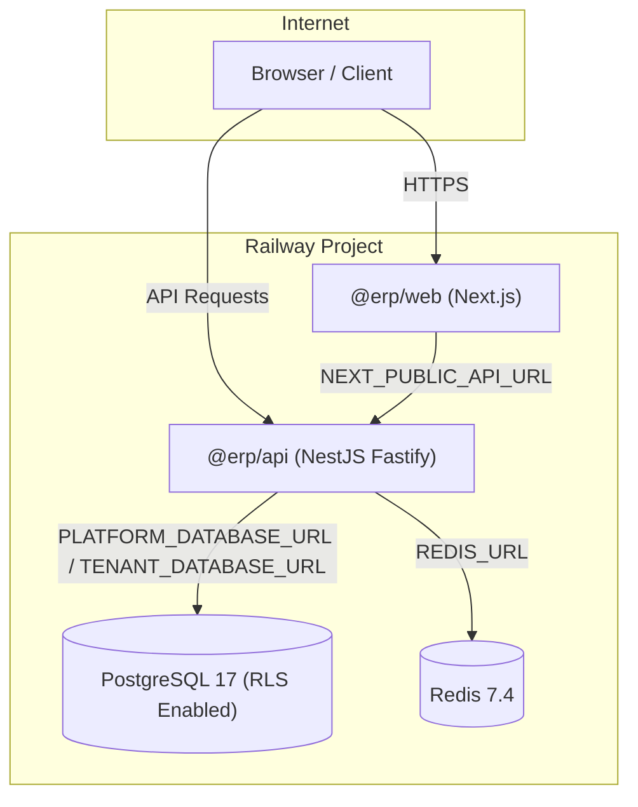

# Railway Production Deployment Guide

This guide details how to deploy the Multi-Tenant ERP Platform to **Railway** ([https://railway.com](https://railway.com)).

---

## 1. Architecture on Railway

A complete deployment consists of **4 interconnected Railway services**:



---

## 2. Prerequisites

1. A [Railway Account](https://railway.com).
2. The GitHub repository containing this codebase (or Railway CLI installed locally).
3. Generated production secrets:
   - **`JWT_ACCESS_SECRET`**: Minimum 32 random characters/bytes (e.g., generate via `openssl rand -hex 32` or Node: `node -e "console.log(crypto.randomBytes(32).toString('hex'))"`).

---

## 3. Step-by-Step Deployment (Railway Dashboard)

### Step 3.1: Create New Project

1. Log in to [Railway](https://railway.com).
2. Click **"+ New Project"**.
3. Select **"Deploy from GitHub repo"** and choose your repository.

---

### Step 3.2: Provision Managed PostgreSQL

1. Inside the project canvas, click **"+ New"** → **"Database"** → **"Add PostgreSQL"**.
2. Railway creates a managed PostgreSQL 17 instance and automatically exposes `DATABASE_URL`.

---

### Step 3.3: Provision Managed Redis

1. In the project canvas, click **"+ New"** → **"Database"** → **"Add Redis"**.
2. Railway creates a managed Redis 7.4 instance and automatically exposes `REDIS_URL`.

---

### Step 3.4: Configure Backend Service (`@erp/api`)

1. In the project canvas, click **"+ New"** → **"GitHub Repo"** → select this repository.
2. Rename the service to `erp-api`.
3. Open **Settings**:
   - **Root Directory**: `/`
   - **Build Command**:
     ```bash
     pnpm --filter @erp/api build && pnpm db:migrate && pnpm db:seed
     ```
   - **Start Command**:
     ```bash
     pnpm --filter @erp/api start
     ```
4. Open **Variables** and add:
   | Variable | Value | Notes |
   |---|---|---|
   | `NODE_ENV` | `production` | Enables production mode |
   | `DATABASE_URL` | `${{Postgres.DATABASE_URL}}` | Auto-reference to Railway Postgres |
   | `PLATFORM_DATABASE_URL` | `${{Postgres.DATABASE_URL}}` | Or dedicated platform role |
   | `TENANT_DATABASE_URL` | `${{Postgres.DATABASE_URL}}` | Or dedicated tenant RLS role |
   | `REDIS_URL` | `${{Redis.REDIS_URL}}` | Auto-reference to Railway Redis |
   | `JWT_ACCESS_SECRET` | _(Paste your 32+ character secret)_ | Required for signing access tokens |
   | `WEB_ORIGIN` | `https://${{erp-web.RAILWAY_PUBLIC_DOMAIN}}` | Allowed origin for CORS & cookies |
   | `SESSION_COOKIE_SECURE` | `true` | Enforces HTTPS-only cookies |
5. Open **Networking**:
   - Click **"Generate Domain"** (e.g. `erp-api-production.up.railway.app`).

---

### Step 3.5: Configure Frontend Service (`@erp/web`)

1. Click **"+ New"** → **"GitHub Repo"** → select this repository.
2. Rename the service to `erp-web`.
3. Open **Settings**:
   - **Root Directory**: `/`
   - **Build Command**:
     ```bash
     pnpm --filter @erp/web build
     ```
   - **Start Command**:
     ```bash
     pnpm --filter @erp/web start
     ```
4. Open **Variables** and add:
   | Variable | Value | Notes |
   |---|---|---|
   | `NODE_ENV` | `production` | Production build |
   | `NEXT_PUBLIC_API_URL` | `https://${{erp-api.RAILWAY_PUBLIC_DOMAIN}}/api/v1` | Public API endpoint for frontend requests |
   | `SESSION_COOKIE_SECURE` | `true` | Secure cookies |
5. Open **Networking**:
   - Click **"Generate Domain"** (e.g. `erp-web-production.up.railway.app`).

---

## 4. Alternative: Deploy via Railway CLI

You already have the Railway CLI installed on this machine (`C:\Users\HP\AppData\Roaming\npm\railway.ps1`).

```powershell
# 1. Login to your Railway account
railway login

# 2. Link or create project
railway init

# 3. Add PostgreSQL and Redis
railway add -d postgres
railway add -d redis

# 4. Deploy service
railway up
```

---

## 5. Verification Checklist

Once both services show **Active**:

- [ ] **API Health Check**: Visit `https://<erp-api-domain>/api/v1/health` → Should return `{"status":"ok"}`.
- [ ] **Swagger Documentation**: Visit `https://<erp-api-domain>/api/v1/openapi.json` → Should return OpenAPI specification.
- [ ] **Frontend Application**: Visit `https://<erp-web-domain>` → Should display the ERP application shell and login screen.
- [ ] **Database Verification**: Check Railway PostgreSQL metrics to confirm tables from `database/migrations` have been created and initial roles/permissions seeded.

---

## 6. Custom Domain (Optional)

If you wish to attach a custom domain or subdomain (e.g., `erp.yourdomain.com`):

1. In `erp-web` Settings → **Networking** → **Custom Domain**.
2. Enter your custom domain and add the generated CNAME record to your DNS provider.
3. Update `WEB_ORIGIN` in `erp-api` to point to `https://erp.yourdomain.com`.
